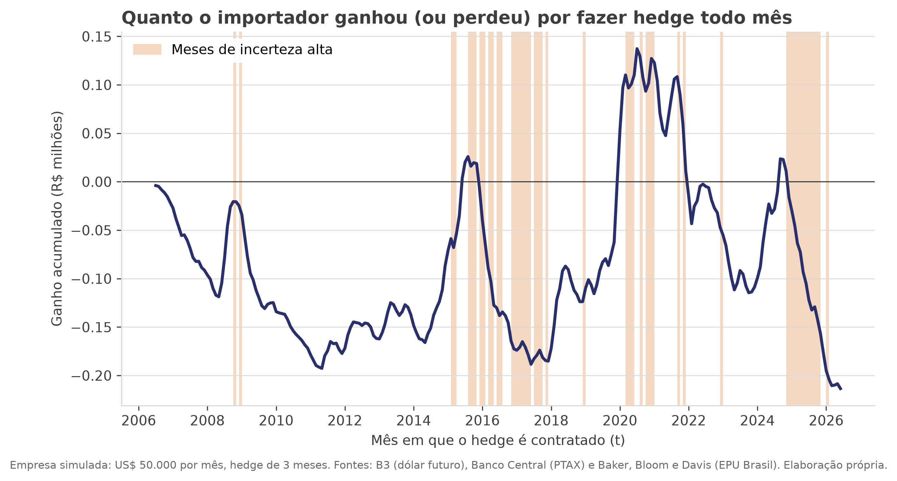
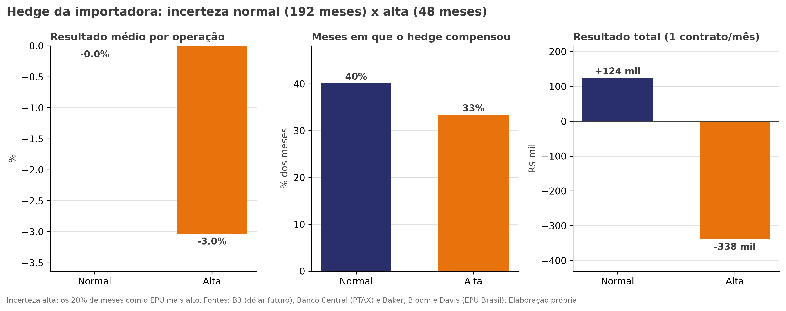
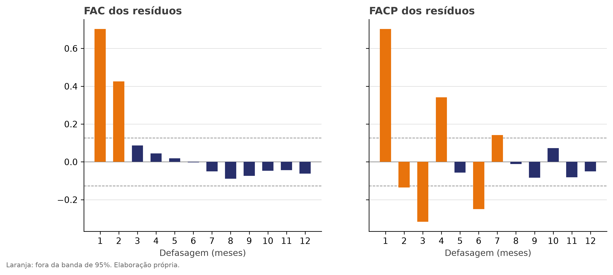

# Hedge cambial e incerteza

Trabalho de Derivativos e Riscos (UFRGS)

Bernardo Fernandes Chevarria e Sofia Marques Ezechiello

**A pergunta.** Uma empresa **importadora** compra mercadoria em dólar todo mês e paga 3
meses depois. Para não correr o risco de o dólar subir, ela trava o câmbio comprando dólar
futuro. O hedge **compensa financeiramente**? E o que acontece quando a **incerteza
econômica** está alta?

A ideia não é medir a eficiência do hedge pela redução de volatilidade, e sim o
**resultado em dinheiro**: a empresa pagou menos ou mais do que pagaria sem hedge?

**Hipótese testada.** H0: β1 = 0 (a incerteza no mês da contratação não prevê o resultado
do hedge) contra H1: β1 ≠ 0, controlando pelo diferencial futuro/spot (forward premium).

Relatório completo, com os gráficos: [relatorio/relatorio_hedge.pdf](relatorio/relatorio_hedge.pdf)

## Resultados principais

### Análise descritiva
240 operações, de jul/2006 a jun/2026, com 1 contrato (US$ 50 mil) por mês:

- Na média, **o hedge custou 0,6% por operação** e compensou em só 39% dos meses
  (resultado acumulado de cerca de −R$ 214 mil, em reais nominais, sem deflacionar).
- **Todo o custo veio dos meses de incerteza alta**: −3,0% por operação, contra 0,0% nos
  meses de incerteza normal.
- O resultado se mantém com outros cortes de "incerteza alta":

  | Incerteza alta = | Meses | Incerteza alta | Incerteza normal |
  |---|---|---|---|
  | 25% de meses mais incertos | 60 | −2,8% | +0,1% |
  | 20% de meses mais incertos | 48 | −3,0% | 0,0% |
  | 10% de meses mais incertos | 24 | −4,8% | −0,2% |

- Leitura: **o hedge protege contra a incerteza que ainda não chegou, não contra a que já
  está aí.** Os maiores ganhos vieram de hedges contratados antes dos choques (meados de
  2008, começo de 2020); contratado com a incerteza já alta, o dólar já subiu e o hedge
  trava um câmbio caro.




### Regressão

Modelo: H_t = ln(S_t+3 / F_t) = β0 + β1·U_t + β2·ln(F_t / S_t) + ε_t (importador), com
erro-padrão de Newey-West (L = 3), porque os hedges de meses vizinhos se sobrepõem.

Modelo principal: β1 = −0,0122 p.p. por ponto de EPU (erro-padrão de Newey-West 0,0046; p = 0,008; n = 240).
Um desvio-padrão a mais de incerteza (cerca de 114 pontos de EPU) está associado a uma queda de cerca de
1,39 p.p. no resultado do hedge da importadora. O poder explicativo é baixo (R² ≈ 3,7%). O coeficiente de
Fama implícito é b = 0,33 (IC 95%: −1,23 a 1,89), largo demais para concluir algo sobre o forward premium puzzle.

| Especificação | n | Unidade do efeito | Efeito (p.p.) | Erro-padrão | p-valor |
|---|---|---|---|---|---|
| Principal (amostra completa) | 240 | +1 d.p. de EPU | −1,39 | 0,52 | 0,008 |
| EPU padronizada | 240 | +1 d.p. de EPU | −1,39 | 0,52 | 0,008 |
| Sem 2020 | 228 | +1 d.p. de EPU | −1,46 | 0,55 | 0,008 |
| Até dez/2024 | 222 | +1 d.p. de EPU | −1,20 | 0,62 | 0,053 |
| Operações sem sobreposição | 80 | +1 d.p. de EPU | −1,78 | 0,72 | 0,014 |
| Dummy: 25% de meses mais incertos | 240 | alta − normal | −2,77 | 1,12 | 0,013 |
| Dummy: 20% de meses mais incertos | 240 | alta − normal | −2,88 | 1,22 | 0,018 |
| Dummy: 10% de meses mais incertos | 240 | alta − normal | −4,46 | 1,26 | < 0,001 |

Associação condicional, não efeito causal. Os meses de incerteza alta se concentram em poucos episódios
(2015–17 e 2025), então o número efetivo de observações independentes é pequeno.

Testes de diagnóstico (ADF, exogeneidade fraca, FAC/FACP dos resíduos, sensibilidade ao
tamanho do Newey-West) estão em `data/processed/regressao_*.csv`.



## Limitações

- "Incerteza alta" usa o percentil 80 da amostra inteira, então não é uma regra que a
  empresa conseguiria aplicar em tempo real (não é ex ante).
- As médias descritivas vêm de hedges com janelas que se sobrepõem, o que reduz o número
  efetivo de observações independentes; poucos episódios (2008, 2020) pesam muito.
- Não entram custos de margem, ajuste diário, corretagem nem custo de oportunidade.
- Os valores em R$ são nominais, somados ao longo de 20 anos.
- O EPU Brasil é construído só com notícias da Folha de S.Paulo e dá um salto em 2025; por
  isso há uma especificação de robustez só até dez/2024.

## Como rodar

1. Abra a pasta do projeto no VS Code (**Arquivo → Abrir Pasta**).
2. **Coloque a planilha do dólar futuro em `data/raw/`**, com o nome começando por
   `dolar_futuro` (ex.: `dolar_futuro_t4_bdi_a_partir_2006-07.xlsx`). Ela não está no
   GitHub porque a pasta `data/raw` fica fora do Git. A base final já pronta está em
   `data/processed/base_hedge.csv`.
3. No terminal do VS Code (**Ctrl + '**), com Python 3.10 ou mais novo:

   ```bash
   python -m venv .venv
   .venv\Scripts\activate          # Windows  (Mac/Linux: source .venv/bin/activate)
   python -m pip install -r requirements.txt
   python main.py
   ```

   Com Anaconda, dá para pular as duas primeiras linhas: escolha o interpretador do
   Anaconda em **Ctrl+Shift+P → Python: Select Interpreter** e rode as duas últimas.

O `main.py` baixa sozinho o EPU e a PTAX (leva menos de um minuto) e guarda tudo em
`data/raw/`. Para baixar de novo: `python main.py --atualizar`. Para a regressão só até
dez/2024: `python main.py --ate 2024-12`. Os testes rodam com `python -m pytest`.
O arquivo `notebook_resultados.py` (células `# %%`) reproduz os resultados descritivos
a partir de `data/processed/base_hedge.csv`.

## O que o programa faz

| Passo | O quê | Arquivo |
|---|---|---|
| 1 | Série de incerteza: **EPU Brasil** (Baker, Bloom e Davis) | `epu.py` |
| 2 | Dólar futuro: ajuste de fim de mês do contrato que liquida em t + 3 (planilha) | `cambio.py` |
| 3 | PTAX: a do dia exato em que cada contrato liquida | `cambio.py` |
| 4 | Base casada: futuro travado em t × PTAX que de fato ocorreu em t + 3 | `base_hedge.py` |
| 5 | Resultado do hedge, em % e em R$ | `base_hedge.py` |
| 6 | Análise descritiva: incerteza alta × normal, por ano e nas crises | `analise.py` |
| 7 | Regressão com ADF, exogeneidade fraca e Newey-West | `regressao.py` |

## Referências

- Baker, S., Bloom, N. e Davis, S. (2016). Measuring Economic Policy Uncertainty.
  *Quarterly Journal of Economics*, 131(4), 1593–1636.
- Fama, E. (1984). Forward and spot exchange rates. *Journal of Monetary Economics*, 14(3), 319–338.
- Hansen, L. e Hodrick, R. (1980). Forward exchange rates as optimal predictors of future
  spot rates. *Journal of Political Economy*, 88(5), 829–853.
- Newey, W. e West, K. (1987). A simple, positive semi-definite, heteroskedasticity and
  autocorrelation consistent covariance matrix. *Econometrica*, 55(3), 703–708.
